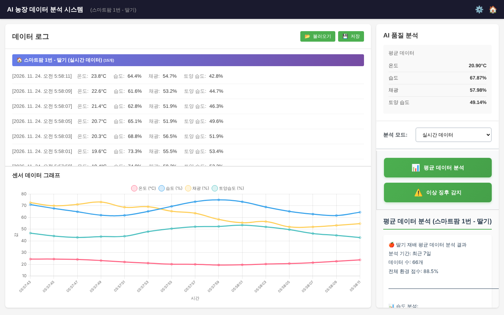

# Flask-SmartFarmFlask - 스마트팜 모니터링·AI 분석 서버

> 📂 [포트폴리오 (Notion)](https://iced-tarsier-455.notion.site/350af40f5e6680d19f93f1653925a3b8) · 🔗 WinForms 클라이언트: [SmartFarmSimulation](https://github.com/yaong832/SmartFarmSimulation)

스마트팜 WinForms 클라이언트([SmartFarmSimulation](https://github.com/yaong832/SmartFarmSimulation))가 보내는 센서 데이터(습도·온도·채광·토양 습도)를 받아 **웹 대시보드로 보여 주고, 작물별 기준으로 분석하고, AI 자동 제어 명령을 돌려주는** Flask 서버입니다.



---

## 구성

```
현장 PC                                          같은 PC 또는 다른 PC
┌──────────────────────────┐  POST /api/sensor-data   ┌─────────────┐
│ TwinCAT PLC (센서·램프)   │                          │   브라우저   │
│ SmartFarmSimulation ─────┼──► Flask (이 저장소) ◄───┼─ GET :5000  │
│   (WinForms)        ◄────┼── POST /api/ai/control   └─────────────┘
└──────────────────────────┘        │
                                    └─ 분석: 작물 기준 규칙 + scikit-learn 모델(학습했을 때)
```

- **작물별 기준**: 사과·토마토·상추·딸기 등 12종의 최적 습도·온도·채광·토양 습도(`crop_config.py`). WinForms에서 작물을 고르면 이 기준을 받아 갑니다.
- **AI 분석**: 평균 데이터 분석, 이상 징후 감지, 생산량 예측(`ai_analysis.py`). `/api/ml/train`으로 모델을 학습하면 scikit-learn 모델(`ml_trainer.py`)도 함께 씁니다.
- **자동 제어**: WinForms가 `/api/ai/control`로 현재 센서 값을 보내면, 작물 기준에서 벗어난 센서마다 올림·내림 명령(`sensor_index`, `action`, `offset`, `reason`)을 돌려줍니다.
- **저장**: 센서 이력은 메모리에만 둡니다. 서버를 끄면 사라집니다. 학습한 모델은 `models/`에 저장됩니다.

---

## 설치와 실행

Python 3.11 이상을 권장합니다.

```bash
python -m venv venv
venv\Scripts\activate          # macOS/Linux: source venv/bin/activate
pip install -r requirements.txt
python app.py
```

Windows에서는 `run_farmui.bat`을 더블클릭해도 됩니다(패키지 설치 후 실행). 서버가 뜨면 브라우저가 `http://localhost:5000`을 자동으로 엽니다.

그다음 SmartFarmSimulation에서 **웹 연결**을 누르면 대시보드에 데이터가 들어옵니다.

- PyCharm에서 실행: [README_PYCHARM.md](README_PYCHARM.md)
- 대시보드 사용법: [WEB_USER_GUIDE.md](WEB_USER_GUIDE.md)

### 환경 변수

| 변수 | 기본값 | 뜻 |
| --- | --- | --- |
| `FARM_FLASK_HOST` | `0.0.0.0` | 바인딩 주소. 같은 PC에서만 쓸 거면 `127.0.0.1` |
| `FARM_FLASK_DEBUG` | 꺼짐 | `1`이면 Flask 디버그 모드. 개발할 때만 켜세요 |

> ⚠️ 인증이 없는 서버입니다. 학교·사내처럼 믿을 수 있는 네트워크에서만 여세요.

> 식각 장비용 Flask([Flask-etchflask](https://github.com/yaong832/Flask-etchflask))와 같은 5000 포트를 쓰므로 동시에 실행하지 마세요.

---

## API

| 메서드 | 경로 | 설명 |
| --- | --- | --- |
| GET | `/` | 대시보드 |
| POST | `/api/sensor-data` | WinForms 센서 데이터 수신 (농장·작물 정보 포함) |
| GET | `/api/sensors` | 현재 농장의 최신 센서 값 |
| GET | `/api/farm` | 농장 1~3번 작물·메모 |
| GET | `/api/crops` | 작물 목록 |
| GET | `/api/crops/<작물>` | 작물별 최적 조건 (WinForms 작물 자동 설정용) |
| POST | `/api/crops` | 작물 추가 (메모리에만 저장) |
| GET, POST | `/api/ai/average` | 평균 데이터 분석 |
| GET, POST | `/api/ai/anomaly` | 이상 징후 감지 |
| GET, POST | `/api/ai/prediction` | 생산량 예측 |
| POST | `/api/ai/analyze` | 위 세 가지를 한 번에 |
| POST | `/api/ai/control` | 자동 제어 명령 생성 (WinForms가 호출) |
| POST | `/api/ml/train` | 모델 학습 (로그 또는 최근 7일 실시간 데이터) |
| POST | `/api/ml/predict-anomaly`, `/api/ml/predict-score` | 학습한 모델로 예측 |
| GET | `/api/ml/status` | 모델 학습 상태 |
| GET | `/api/logs`, `/api/load-logs` · POST `/api/add-logs` | 메모리 로그 조회·추가 |

## 파일

| 파일 | 역할 |
| --- | --- |
| `app.py` | Flask 라우트 |
| `data_manager.py` | 센서·농장 데이터, 로그 (메모리) |
| `crop_config.py` | 작물별 최적 조건 |
| `ai_analysis.py` | 평균·이상 징후·생산량 분석, 제어 명령 |
| `ml_trainer.py` | scikit-learn 모델 학습·예측·저장 |
| `templates/index.html` | 대시보드 (단일 HTML) |
| `docs/` | 개발 중 작성한 검토 보고서, AI 학습 전략, 모델 저장 설명 |
